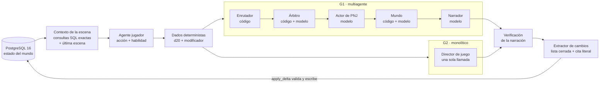

# DM-IA · Coherencia narrativa: sistema multiagente vs. monolítico


Tesis de Ingeniería de Sistemas e Inteligencia Artificial (UPAO, 2026).
Marin Yupanqui, Bryan Arturo · Mostacero Cieza, Luis David. Asesor: Dr. Cueva Chávez, Walter Manuel.

**Pregunta:** ¿es superior la coherencia narrativa de las campañas de Dungeons & Dragons generadas por un sistema multiagente (G1) frente a uno monolítico (G2)?

**Diseño:** experimental de medidas repetidas con pares emparejados. Son 27 escenarios, cada uno generado con G1 y con G2, de 1,400 turnos por campaña: 54 campañas y 75,600 turnos. Ambos brazos usan el mismo modelo (`google/gemma-4-31B-it`, DeepInfra) y la misma memoria estructurada en PostgreSQL.

**Resultado:** la hipótesis general no se sostiene. La única ventaja de G1 está en el respeto a la agencia del jugador: 0.17 % frente a 3.47 % de turnos con usurpación.

---

## Arquitectura



- **Ciclo del turno común:** estado → contexto → jugador → dados → narración → verificación → extractor → estado. Lo único que cambia entre brazos es quién produce la narración.
- **Memoria estructurada común:** el mundo vive en la base, no en el modelo. Ningún LLM escribe en ella: el extractor propone cambios con una cita literal del turno y `apply_delta()` los valida contra una lista blanca de 19 campos. Las magnitudes las fija una tabla según la personalidad del PNJ.
- **Medición:** instrumentos deterministas (solo `SELECT`, sin LLM), validados con pruebas de perturbación y, donde interpretan texto, con evaluadores humanos externos. pgvector (bge-m3) se usó solo después, como capa de medición exploratoria; no interviene en la generación.

| Componente | Dónde |
| --- | --- |
| Turno G2 (monolítico) | [`orquestador/vertical_slice.py`](orquestador/vertical_slice.py) |
| Turno G1 (multiagente) | [`orquestador/vertical_slice_g1.py`](orquestador/vertical_slice_g1.py) con [`router.py`](orquestador/router.py), [`arbitro.py`](orquestador/arbitro.py) y [`mundo.py`](orquestador/mundo.py) |
| Acceso al estado y escritura validada | [`orquestador/db.py`](orquestador/db.py) y [`migrations/001_schema.sql`](migrations/001_schema.sql) |
| Prompts del DM y de los roles de G1 | [`dm/`](dm/) |
| Agente jugador, dados y 27 personajes | [`jugador/`](jugador/) |
| Extractor (contrato y prompts) | [`extractor/`](extractor/) |
| Huella del modelo | [`entorno/`](entorno/) |
| Reporte de validación por campaña | [`orquestador/reporte_validacion.py`](orquestador/reporte_validacion.py) |

## Estructura del repositorio

| Bloque | Carpeta | Contenido |
| --- | --- | --- |
| **Sistema** | `orquestador/` `dm/` `jugador/` `extractor/` `migrations/` `entorno/` | Motor DM-IA (tabla de arriba) |
| | `docker-compose.yml` `pgadmin-servers.json` `.env.example` | Base de datos local y configuración |
| **Experimento** | [`corpus/`](corpus/) | Lore de cada escenario (`pilotos/` y `real/`) |
| | [`fixtures/`](fixtures/) | Mundo y PNJ de cada escenario, con su validador |
| | [`scripts/`](scripts/) | Operación, medición y análisis (ver [`scripts/README.md`](scripts/README.md)) |
| | [`sondeos/`](sondeos/) | Pruebas previas del proveedor (concurrencia, sesión) |
| **Datos** | [`logs/`](logs/) | Bitácoras de ejecución por par y del supervisor |
| | [`transcripciones/`](transcripciones/) | Transcripciones completas (pares 02–06, 07–17 y 18–27) |
| | [`datos_v2/`](datos_v2/) | Mediciones por turno, por bloque y por campaña |
| | [`validacion/`](validacion/) | Validación humana externa: muestras, claves y etiquetas |
| **Resultados** | [`docs/`](docs/) | Resultados, reportes, especificaciones e IDs (ver [`docs/README.md`](docs/README.md)) |
| **Tesis** | [`tesis/`](tesis/) | Documento vigente (`TESIS2.docx.md`), versiones, figuras y audio de asesoría |
| | [`sustentacion/`](sustentacion/) | Deck oficial UPAO, propuestas, generadores y guiones |
| | [`entregas/`](entregas/) | Paquetes entregados al asesor |

---

## Replicar el experimento

Todos los comandos se ejecutan **desde la raíz del repositorio**: las rutas de los scripts son relativas a ella. En Windows, conviene fijar `$env:PYTHONUTF8="1"` en la sesión.

### 1. Requisitos

- Docker (PostgreSQL 16 con pgvector y pgAdmin).
- Python 3.12 o superior.
- Java 8 o superior, solo para la gramaticalidad con LanguageTool (CR-1); sin Java, esa sección se omite sola.
- Una clave de [DeepInfra](https://deepinfra.com) (ver [`docs/guias/SETUP_DEEPINFRA.md`](docs/guias/SETUP_DEEPINFRA.md)).

### 2. Configurar y levantar la base

```powershell
copy .env.example .env          # completar DEEPINFRA_API_KEY, DMIA_MODELO, POSTGRES_PASSWORD, DATABASE_URL
docker compose up -d            # dmia_db (puerto 5432) y dmia_pgadmin (http://localhost:5050)
```

Al crearse el volumen por primera vez, PostgreSQL aplica [`migrations/`](migrations/) (esquema completo y tabla de medición semántica).

### 3. Dependencias de Python

```powershell
py -m pip install -r orquestador/requisitos.txt numpy scipy pytest
py -m spacy download es_core_news_sm
py -m pip install sentence-transformers huggingface_hub   # solo para el instrumento semántico exploratorio
```

### 4. Verificar el modelo (antes de cada tanda)

```powershell
py entorno/verificar_modelo.py --modelo $env:DMIA_MODELO --comparar entorno/manifiesto_2026-08-28.json
```

Compara la huella de tres prompts fijos a temperatura 0 y sale con código 2 si el proveedor cambió el artefacto. El experimento usa un solo proveedor y ningún enrutador.

### 5. Crear y sembrar las campañas

```powershell
py scripts/validar_fixtures_real.py 18 19 20                 # valida mundo y PNJ de cada par
py scripts/crear_sembrar_par18-27.py 18 19 20                # crea G2 y G1 sobre el mismo tenant y siembra ambos mundos
```

Los `campaign_id` se guardan en `docs/ids_par18-27.json` (los pares 07–17 usan `crear_sembrar_par07-17.py` y `docs/ids_par07-17.json`).

### 6. Generar los 1,400 turnos

```powershell
py -u scripts/supervisor.py --arm ambos --pares 18,19,20 --ids docs/ids_par18-27.json --log logs/supervisor_par18-27.log
```

El supervisor mantiene un proceso por campaña y relanza los caídos con `1400 − current_turn`. También se puede generar una campaña a mano:

```powershell
py orquestador/vertical_slice.py    --campaign-id <UUID-G2> --pj PJ27 --turnos 1400
py orquestador/vertical_slice_g1.py --campaign-id <UUID-G1> --pj PJ27 --turnos 1400
```

Con `--seco`, el turno se ejecuta sin escribir en la base.

### 7. Medir y analizar (sin LLM, solo lectura)

```powershell
py orquestador/reporte_validacion.py --campaign-id <UUID>         # reporte de validación de una campaña
py scripts/reporte_v2/recalcular.py                                # instrumentos por turno     -> datos_v2/par*_G?.csv
py scripts/reporte_v2/recalcular_booleanos.py                      # detectores con tiradas     -> datos_v2/booleanos/
py scripts/reporte_v2/recalcular_persona2.py                       # usurpación de la agencia   -> datos_v2/persona2/
py scripts/reporte_v2/recalcular_campana.py                        # instrumentos por campaña   -> datos_v2/campana/
py scripts/instrumentos/distribucion_a4bc_27.py                    # respuesta a la acción (z) por bloque
py scripts/reporte_v2/medidas_cierre.py                            # medidas por bloque         -> datos_v2/cierre/
py scripts/reporte_v2/page_test.py                                 # degradación de G2 (H1a–H1c)
py scripts/reporte_v2/consolidar.py --B 10000                      # comparación G1 vs G2 (H1d–H1f)
py scripts/reporte_v2/resultados_tesis.py                          # paquete de resultados por objetivo
py scripts/reporte_v2/cierre_brechas.py                            # docs/cierre_brechas.md
```

Las salidas quedan en [`docs/resultados/`](docs/resultados/) y [`docs/reportes/`](docs/reportes/). Las pruebas de sensibilidad de cada instrumento están en [`scripts/sensibilidad/`](scripts/sensibilidad/), con sus expectativas selladas con SHA-256.

> **Nota sobre la réplica.** Los dados son deterministas, pero las llamadas al modelo no llevan semilla: una nueva corrida reproduce el procedimiento y la medición, no el mismo texto. Los análisis de este repositorio se reproducen exactamente sobre la base y los datos del corpus original.
