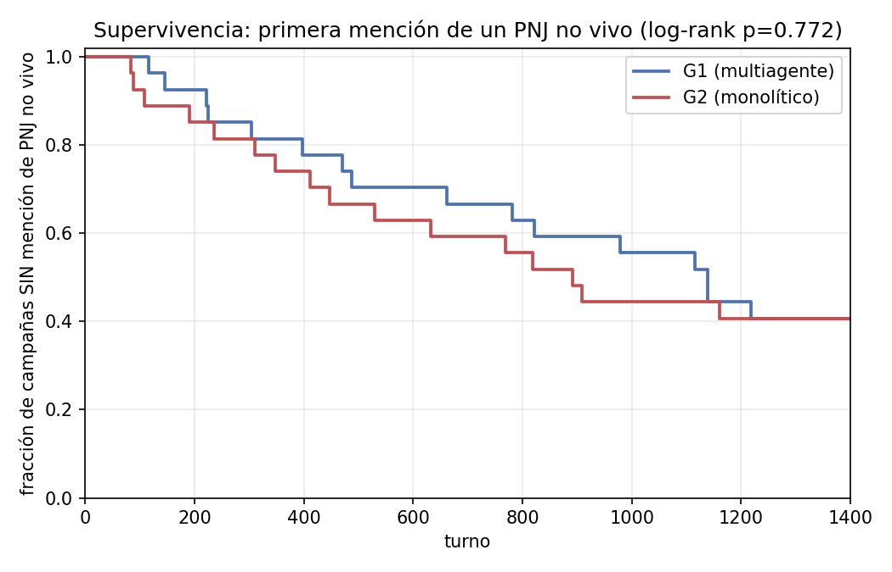

# Kaplan-Meier: primera mención narrada de un PNJ no vivo (t_pnj)

Evento = primer turno en que la narración menciona a un PNJ no vivo como si actuara (`cl2_pnj_inactivo_actua` v2; columna `t_pnj` de `datos_v2/cierre/por_campana.csv`). Censurado en el turno 1400 si nunca ocurre (mismo límite HASTA que el resto del consolidado v2). Sobrevivir más tiempo = menos degradación del linaje causal (mejor).

## Resumen por brazo

| brazo | n | eventos | censurados | mediana (turno) |
|---|---|---|---|---|
| G1 | 27 | 16 | 11 | 1139 |
| G2 | 27 | 16 | 11 | 891 |

## Log-rank (Mantel-Haenszel, bilateral)

| comparación | O(G1) | E(G1) | χ² | p |
|---|---|---|---|---|
| las 27 parejas | 16.0 | 16.82 | 0.084 | 0.7718 |
| Par01-17 (sin reloj) | 10.0 | 9.24 | 0.123 | 0.7257 |
| Par18-27 (con reloj) | 6.0 | 7.47 | 0.682 | 0.4089 |

O(G1)/E(G1) = eventos observados/esperados bajo H0 (misma supervivencia) en G1, sumados sobre los turnos con al menos un evento en cualquiera de los dos brazos. p < 0.05 ⇒ las curvas difieren.

## Curva

## Límites

- Censura en 1400 turnos: 11/27 campañas de cada brazo nunca narran un PNJ no vivo actuando dentro de la ventana observada; el estimador KM ya lo trata como censura (no como ausencia de evento), pero la cola de la curva más allá del último evento observado no está identificada.
- `t_pnj` mide MENCIÓN, no acción — la misma limitación que ya declara la fila `cl2_pnj_inactivo_actua` del consolidado (Auditar la precisión de `cl2_pnj_inactivo_actua`, fase posterior); esto no la resuelve, solo cambia la forma del análisis (curva de supervivencia en vez de proporción cruda por umbral).
- No pareado: el log-rank agrupado trata las 27 parejas de cada brazo como dos muestras independientes, no aprovecha el diseño pareado por escenario que usa el resto del consolidado (HL/Wilcoxon por pareja). Un log-rank estratificado por pareja sería más consistente con esa convención pero no está implementado aquí; la comparación por lote (Par01-17 vs Par18-27) es el único control de robustez incluido.
