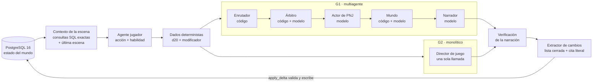

## Principios

- **Ciclo común:** estado → contexto → jugador → dados → narración → verificación → extractor → estado. Lo único que cambia entre brazos es quién produce la narración.
- **Memoria estructurada común:** el mundo vive en la base, no en el modelo. Ningún LLM escribe en ella: el extractor propone cambios con una cita literal del turno y `apply_delta()` los valida contra una lista blanca de 19 campos. Las magnitudes las fija una tabla según la personalidad del PNJ.
- **Medición independiente:** instrumentos deterministas (solo `SELECT`, sin LLM), validados con pruebas de perturbación y evaluadores humanos externos. pgvector (bge-m3) solo se usó después, como capa exploratoria.

## Componentes

| Componente | Código |
| --- | --- |
| Turno G2 (monolítico) | [`motor/orquestador/vertical_slice.py`](referencia/motor/orquestador/vertical_slice.md) |
| Turno G1 (multiagente) | [`vertical_slice_g1.py`](referencia/motor/orquestador/vertical_slice_g1.md), [`router.py`](referencia/motor/orquestador/router.md), [`arbitro.py`](referencia/motor/orquestador/arbitro.md), [`mundo.py`](referencia/motor/orquestador/mundo.md) |
| Estado y escritura validada | [`db.py`](referencia/motor/orquestador/db.md) y `motor/migrations/001_schema.sql` |
| Prompts | `motor/dm/` (DM y roles de G1) y `motor/extractor/` (contrato, grounder, verificador) |
| Jugador, dados y 27 personajes | [`motor/jugador/`](referencia/motor/jugador/dados.md) |
| Huella del modelo | [`motor/entorno/verificar_modelo.py`](referencia/motor/entorno/verificar_modelo.md) |
| Reporte de validación por campaña | [`reporte_validacion.py`](referencia/motor/orquestador/reporte_validacion.md) |
